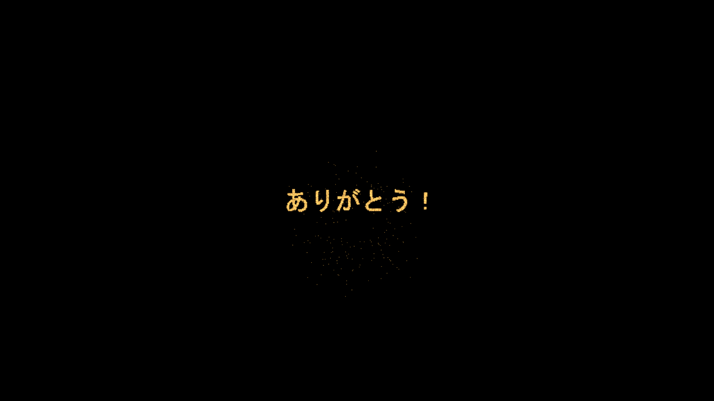
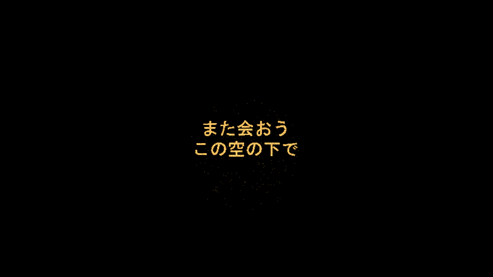

# 検証記録

## 検証環境

- Unity 2022.3.22f1 / Windows / Built-in Render Pipeline
- VRChat Base・Worlds SDK 3.10.4（既存プロジェクトから専用検証環境へコピー）
- UdonSharp：上記Worlds SDKに同梱のもの
- TextMesh Pro 3.0.6

## 実施状況

2026-10-19に、専用の検証ワールドで次の項目を確認しました。

| 確認項目 | 結果 |
|---|---|
| UnityのC#コンパイル | 成功 |
| 日本語「ありがとう！」 | 1,065点を生成 |
| 英数字 | 生成成功 |
| 複数行「また会おう／この空の下で」 | 2,477点を生成 |
| 空文字・未収録文字・点数上限超過 | エラーとして検出 |
| 点群の中央配置・乱数の再現性 | 自動検証成功 |
| GPU描画 | 上昇・展開・文字・落下・開始前／終了後の非表示を確認 |
| 30mからの文字の見え方 | 出力画像で日本語・複数行を確認 |
| UdonSharpのワールド用変換 | 成功 |
| Prefab保存・再読み込み・別名保存 | 成功 |
| ボタンと発射台の接続 | 保存後の参照を確認 |
| 生成Prefabのフォント非依存 | 依存アセットにフォントが含まれないことを確認 |
| 同梱サンプル2種類 | 元の生成データをAssetsから外し、サンプルだけの配置・参照・Udon変換を確認 |
| VRChat SDKのローカルワールドバンドル生成 | 成功（`.vrcw`を出力、アップロードなし） |
| unitypackage | 出力・実際のインポートとも成功。UPM版を外した状態で、C#・Udon変換・サンプル参照・フォント非依存を確認 |

SDKビルドは、SDKのビルド要求コールバック・Udon処理・ワールドのAssetBundle出力を通しています。
SDKコントロールパネルの画面操作、VRChatクライアント起動、ログイン、公開は行っていません。




## 手動受け入れ確認

- [ ] Unityエディターの日本語UIを操作し、プレビューの再生・停止・時間指定ができる。
- [x] 30mの観覧位置から「ありがとう！」と複数行の文章を読める（GPU描画の出力画像で確認）。
- [ ] フォント未指定、空文字、未収録文字、点数超過を生成前に案内する。
- [ ] 保存済みの設定を開いて編集し、既存Prefabを上書きせず別名保存できる。
- [ ] Prefabを移動・回転し、発射位置と開花位置を変更できる。
- [ ] Unity Play Modeで打ち上げ、任意の上昇音・開花音を確認する。
- [ ] 新規ワールドへローカルパッケージとして導入できる。
- [x] UPM版を外した検証ワールドへunitypackageを導入し、参照切れやアセンブリ重複がない。
- [x] VRChat SDKでワールドのローカルバンドルをビルドできる。
- [ ] VRChatの2クライアントで同じ文章・進行段階が表示される。
- [ ] 連打で多重発射せず、終了後に再発射できる。
- [ ] 再生中の途中参加は現在の段階から表示し、終了後の参加では表示しない。
- [ ] 所有者退出後も表示が続き、新しい所有者で再発射できる。
- [ ] 複数の発射台・ボタンが互いに干渉しない。
- [ ] PC VRの両眼で火花が表示される。

## バッチ検証

専用の検証用ワールドに本パッケージを導入してから実行します。
`FireworkValidation.Run`は検証用フォント・Prefab・デモシーンをAssetsへ作り、現在のシーンを切り替えるため、制作中のワールドでは実行しないでください。

```powershell
& 'C:\Program Files\Unity\Hub\Editor\2022.3.22f1\Editor\Unity.exe' `
  -batchmode -projectPath '<検証用ワールド>' `
  -executeMethod TextureFireWorks.Editor.FireworkValidation.ImportResources `
  -logFile '<素材導入ログ>'

& 'C:\Program Files\Unity\Hub\Editor\2022.3.22f1\Editor\Unity.exe' `
  -batchmode -quit -projectPath '<検証用ワールド>' `
  -executeMethod TextureFireWorks.Editor.FireworkValidation.Run `
  -tfwFont '<日本語対応フォントファイルの絶対パス>' `
  -tfwOutput '<検証出力フォルダーの絶対パス>' `
  -logFile '<検証ログ>'
```

GPU描画も確認するため、`-nographics`は使用しません。成功時はログに`TFW_VALIDATION_PASSED`が出ます。
フォントファイル・TMPフォント・検証用テクスチャはローカル検証環境だけで使用し、配布物へ含めません。
